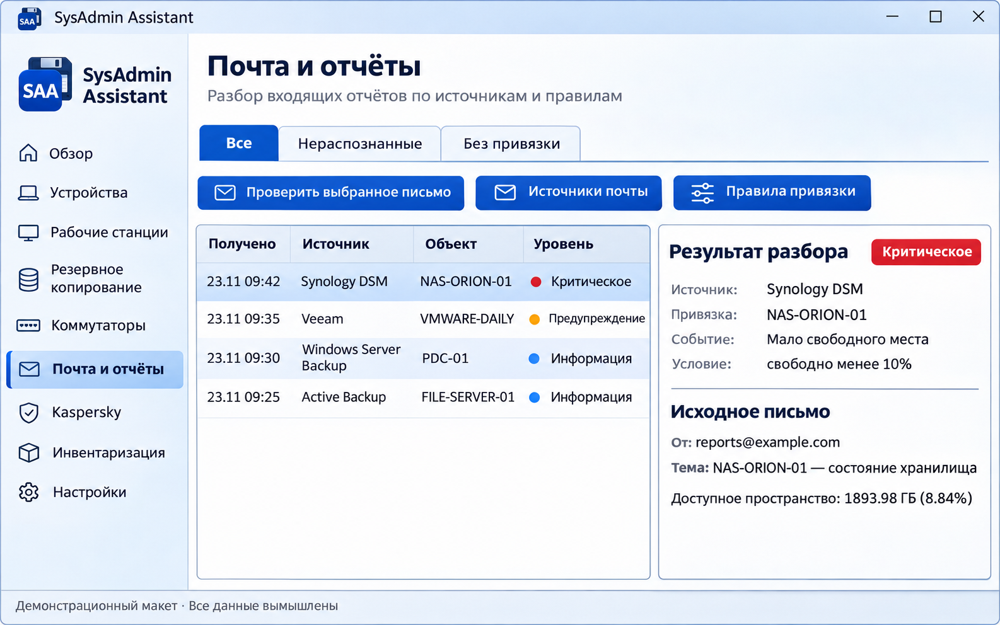

# SysAdmin Assistant



**Анализ почтовых отчётов: от входящего письма до понятной проблемы и уведомления.**

SysAdmin Assistant собирает технические письма из IMAP-ящиков, распознаёт отчёты, связывает их с устройствами и заданиями резервного копирования и определяет результат по встроенным обработчикам и пользовательским правилам. Ошибки, предупреждения и пропущенные отчёты становятся видимыми в одном интерфейсе и могут отправляться в Telegram.

**Главный акцент — разбор содержания писем**, включая числовые условия и повторную проверку после изменения правил. Мониторинг серверов, рабочих станций и сетевого оборудования дополняет почтовый анализ; связанная инвентаризация помогает вести учёт наблюдаемых объектов. Сервер выполняет обработку независимо от открытого клиента.

*Изображение выше — демонстрационный макет с вымышленными данными; расположение элементов может отличаться от текущего интерфейса.*

[Сайт программы](https://assistant.321.su) · [Руководство пользователя](docs/USER_GUIDE_RU.md) · [История изменений](CHANGELOG.md) · [English below](#english)

## Разбор почты: от письма к понятному состоянию

Вместо ручного просмотра множества писем можно собрать отчёты из нескольких IMAP-ящиков и обрабатывать их на сервере.

- **Распознавание источников.** Встроенные обработчики поддерживаемых отчётов и пользовательские словари.
- **Привязка к объектам.** Сопоставление письма с устройством или заданием по теме, тексту и настроенным условиям.
- **Анализ результата.** Выделение ошибок и предупреждений с присвоением уровня: информация, предупреждение или критическое событие.
- **Числовые условия.** Сравнение значений из текста с заданными порогами — например, процента свободного места. Условия задаются через текстовые ориентиры без подсчёта позиций символов.
- **Повторная обработка.** Выбранное письмо можно проверить заново после изменения словаря или правил.
- **Исходное сообщение.** Доступ к теме, отправителю и содержимому письма для расследования причины.
- **Контроль резервного копирования.** Учёт расписания и отсутствующих отчётов, чтобы отличать полученный результат от просроченной проверки.

Среди поддерживаемых источников отчётов — Synology Active Backup for Business, DSM, QNAP, Veeam, SQLBackupAndFTP и Windows Server Backup. Формат и полнота разбора зависят от источника и настроенных правил; для собственных писем предусмотрены пользовательские условия.

Пример: письмо о малом свободном месте связывается с NAS, числовое условие определяет уровень проблемы, а результат отображается в мониторинге и может быть отправлен в Telegram.

[Почта и DMARC](docs/MAIL_AND_DMARC.md) · [Настройка источников и правил](docs/MAIL_SOURCES.md)

## Дополнительные возможности: мониторинг и инвентаризация


*Изображения на этой странице — иллюстрации возможностей программы.*

| Раздел | Что можно делать |
|---|---|
| Обзор | Видеть сводку состояний, критические проблемы и предупреждения |
| Устройства | Следить за доступностью, показателями агентов и событиями Windows |
| Рабочие станции | Просматривать версию ОС, аптайм, пользователя, IP-адреса, серийный номер и обновления |
| Оборудование | Получать сведения о процессоре, плате, BIOS, модулях памяти, накопителях и периферии, если они доступны агенту |
| История оборудования | Отслеживать обнаруженные изменения конфигурации и просматривать их в связанных карточках имущества |
| Резервное копирование | Разбирать отчёты, учитывать расписание и контролировать поступление результатов |
| MikroTik | Выполнять мониторинг и анализ конфигурации с доступом на чтение |
| Kaspersky Security Center | Просматривать полученные события и проблемы, использовать правила их классификации |
| Инвентаризация | Вести имущество и сотрудников, связывать карточки с мониторингом, оформлять выдачу, возврат и списание |
| Почта и DMARC | Обрабатывать почтовые отчёты и анализировать DMARC-данные |
| Счета | Учитывать сроки оплаты и состояние обязательств |
| Пароли | Хранить учётные данные в зашифрованном хранилище с разграничением доступа |
| Уведомления | Настраивать отправку событий в Telegram, уровни и задержку уведомлений |

Функции зависят от настроек, прав пользователя, доступности интеграций и сведений, которые предоставляет конкретное устройство. Агент предназначен для мониторинга и не предоставляет удалённый рабочий стол.

## Как устроена программа

- **Сервер** выполняет проверки, обрабатывает письма и отчёты, хранит данные и отправляет уведомления.
- **Клиент Windows** предоставляет интерфейс для просмотра, настройки и учёта. Его можно закрыть: сервер продолжит работу.
- **Агенты** передают сведения с наблюдаемых компьютеров. Для Windows-рабочих станций предусмотрен общий MSI-пакет, создаваемый через интерфейс программы.
- **Доступ пользователей** настраивается по разделам. Новые рабочие станции требуют подтверждения администратором.

Не каждому устройству требуется агент: доступные способы мониторинга зависят от его типа.

## Скачать и начать работу

Готовые установщики публикуются в разделе **Releases** этого репозитория. Выберите нужный выпуск и скачайте установщик сервера и клиента либо соответствующие комплекты папок. Автоматический архив **Source code** содержит исходники и не заменяет установщик.

1. Установите сервер и настройте базу данных, HTTPS и разрешённые сети.
2. Установите клиент и подключитесь к серверу.
3. Настройте доступ пользователей, добавьте устройства и задания резервного копирования.
4. Подключите IMAP-ящики и задайте источники отчётов и правила привязки.
5. При необходимости создайте MSI рабочих станций, разверните его и подтвердите новые компьютеры.
6. Настройте Telegram и проверьте обработку на тестовом письме и тестовом устройстве.

В версии 0.46.14 дополнены выбор RU/EN в графических установщиках и деинсталляторе, переключение языка клиента и окна управления сервером без перезапуска. Исходные письма, журналы и пользовательские названия сохраняются без перевода. Удаление по умолчанию сохраняет данные.

[Руководство на русском](docs/USER_GUIDE_RU.md) · [Рабочие станции и MSI](docs/WORKSTATIONS.md) · [Настройка KSC](docs/KSC-DICTIONARY.md)

## Сборка из исходников

Для сборки используется **Windows x64 и .NET 10 SDK**, совместимый с `global.json`. SDK нужен на компьютере сборки; требования к runtime на целевых компьютерах приведены в инструкции.

```bat
VERIFY.cmd
PUBLISH.bat
```

`VERIFY.cmd` собирает решение и запускает предусмотренные проверки. `PUBLISH.bat` запускает публикацию выпуска с выбором установщиков, комплектов папок и дополнительных компонентов. Полный порядок подготовки WiX, runtime и подписываемых пакетов описан в документации.

Сборка исходников сама по себе не подтверждает работу установщиков и всех аппаратных провайдеров на каждой версии Windows. Проверяйте развёртывание на тестовой машине перед массовой установкой.

[Инструкция сборки](docs/BUILD.md) · [Обновления и резервные копии](docs/UPDATES.md) · [Безопасность и подписи](docs/SECURITY.md)

## Лицензия

Программа распространяется под собственной **[SysAdmin Assistant Source-Available License](LICENSE.txt)**. Основной текст лицензии — английский.

- Разрешено бесплатное использование дома и внутри организаций, включая коммерческие.
- Разрешены изучение и изменение кода для собственных нужд.
- Бесплатное распространение допускается с соблюдением условий лицензии.
- Разрешено брать оплату за установку, настройку, обучение, сопровождение и другие услуги, предусмотренные лицензией.
- Продажа программы, её изменённых версий и включение в платные продукты требуют отдельного письменного разрешения правообладателя.

Это публично доступный исходный код с ограничениями на коммерческое распространение, а не лицензия Open Source, одобренная OSI. Полный текст лицензии имеет преимущество перед этим кратким описанием. Сторонние компоненты сохраняют [собственные лицензии](THIRD_PARTY_NOTICES.md); ранее правомерно предоставленные права не отменяются задним числом.

## Ошибки, предложения и участие

Сообщения о воспроизводимых ошибках и предложения оставляйте в **Issues**. Укажите версию, компонент, способ установки и последовательность действий. Правила внесения изменений находятся в [CONTRIBUTING.md](CONTRIBUTING.md).

Не публикуйте пароли, токены, закрытые ключи, базы, персональные данные и неочищенные рабочие журналы. О предполагаемых уязвимостях сообщайте отдельно по инструкции [SECURITY.md](SECURITY.md).

**Сайт:** [assistant.321.su](https://assistant.321.su)  
**Контакт:** support@321.su

---

## English

**Email report analysis: turn incoming messages into clear issues and notifications.**

SysAdmin Assistant collects technical email from IMAP mailboxes, recognizes reports, links messages to devices and backup jobs, and evaluates results using supported parsers and custom rules. Errors, warnings and missing reports become visible in one application and can trigger Telegram notifications.

Email analysis is the main focus. Server, workstation and network monitoring provide additional context, while linked asset records support equipment accounting. The server processes reports independently of the desktop client. The image at the top is a demonstration mockup with fictional data; its layout may differ from the current application.

[Project website](https://assistant.321.su) · [English user guide](docs/USER_GUIDE_EN.md) · [Changelog](CHANGELOG.md)

### Turn email reports into monitoring results

Email report analysis is a core feature. The server collects messages from multiple IMAP mailboxes, identifies supported report formats and applies configurable matching and classification rules.

- Link messages to monitored devices and backup jobs using subject and body conditions.
- Analyze reported results and assign informational, warning or critical severity.
- Compare numeric values extracted using text anchors against configurable thresholds.
- Reprocess a selected message after changing dictionaries or rules.
- Inspect the original sender, subject and message content when investigating a result.
- Check report arrival against backup schedules and identify overdue results.
- Send resulting notifications to Telegram according to configuration.

Supported report sources include Synology Active Backup for Business, DSM, QNAP, Veeam, SQLBackupAndFTP and Windows Server Backup. Parsing depends on the report format and configured rules; custom text and numeric conditions support organization-specific messages.

For example, a low-disk-space email can be linked to a NAS, classified by a numeric threshold and displayed as an issue with a Telegram notification.

[Email and DMARC](docs/MAIL_AND_DMARC.md) · [Report sources and rules](docs/MAIL_SOURCES.md)

### Monitoring and asset management

| Area | Capabilities |
|---|---|
| Dashboard | Consolidated statuses, critical issues and warnings |
| Devices | Availability, agent metrics and Windows events |
| Workstations | OS version, uptime, user, IP addresses, serial number and updates |
| Hardware | Available CPU, motherboard, BIOS, RAM module, disk and peripheral details |
| Hardware history | Detected configuration changes in monitoring and linked asset records |
| Backups | Report analysis, schedules and missing-result checks |
| MikroTik | Read-only monitoring and configuration analysis |
| Kaspersky Security Center | Collected events, issues and classification rules |
| Inventory | Assets, employees, monitoring links, issue/return/write-off documents |
| Email and DMARC | Report processing and DMARC analysis |
| Bills and credentials | Payment tracking and an encrypted credential vault |
| Notifications | Telegram delivery, severity selection and notification delays |

Availability depends on configuration, permissions, integrations and the information supplied by each device. Hardware collection may be incomplete on individual machines. Agents provide monitoring, not remote desktop access. Illustrations above are conceptual product artwork.

### Components and deployment

The **server** performs checks, processes reports, stores data and sends notifications.
The **Windows client** provides the management interface; monitoring continues after it is closed.
**Agents** collect endpoint data. A shared Windows workstation MSI can be created from the application; new workstations require administrator approval. User access is controlled by application section.

Ready-to-install packages are published under this repository's **Releases**. Automatically generated **Source code** archives contain source files rather than installers.

1. Install the server and configure its database, HTTPS endpoint and permitted networks.
2. Install and connect the desktop client.
3. Configure users, devices and backup jobs.
4. Connect IMAP mailboxes and configure report sources and matching rules.
5. Deploy workstation agents if needed and approve new endpoints.
6. Configure Telegram and verify the setup with test devices and reports.

Version 0.46.14 includes RU/EN selection to graphical setup and removal tools, and live language switching in the desktop client and server management window. Original emails, logs and user-defined names remain unchanged. Uninstalling keeps data by default.

[User guide](docs/USER_GUIDE_EN.md) · [Workstation deployment](docs/WORKSTATIONS.md) · [KSC configuration](docs/KSC-DICTIONARY.md)

### Building from source

Use **Windows x64 and the .NET 10 SDK** compatible with `global.json`:

```bat
VERIFY.cmd
PUBLISH.bat
```

The SDK is required on the build machine. Target runtime requirements and optional WiX/runtime packaging are described in [BUILD.md](docs/BUILD.md). Validate installers and hardware collection on test Windows machines before a broad deployment; compiling source alone does not verify those behaviors.

Keep publisher private keys outside the repository. Included public verification keys are intentional. Modified distributions must be identified and use an appropriate independent publisher identity.

[Build instructions](docs/BUILD.md) · [Updates and backups](docs/UPDATES.md) · [Security and signing](docs/SECURITY.md)

### License

The custom English [SysAdmin Assistant Source-Available License](LICENSE.txt) permits free personal use and internal use by organizations, including commercial organizations. Internal modification and free redistribution are permitted subject to the license. Paid installation, configuration, training and support services are permitted. Selling the Software or modified versions, or including them in paid products, requires separate written permission.

This is source-available software, not software under an OSI-approved open-source license. The full license controls over this summary. [Third-party components](THIRD_PARTY_NOTICES.md) retain their own licenses. Previously valid license grants are not retroactively revoked.

### Reporting issues and contributing

Use **Issues** for reproducible bugs and feature requests. Include the version, affected component, deployment method and reproduction steps. Read [CONTRIBUTING.md](CONTRIBUTING.md) before submitting changes.

Do not publish credentials, private keys, database copies, employee information or unredacted production logs. Report suspected vulnerabilities privately as described in [SECURITY.md](SECURITY.md).

**Website:** [assistant.321.su](https://assistant.321.su)  
**Contact:** support@321.su
